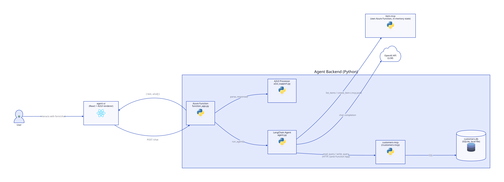

# A2UI MCP LangChain Demo

A chat agent that manages an item catalog and looks up customer records
through [MCP](https://modelcontextprotocol.io/) tools, and renders its
responses as either plain text or live, interactive UI (forms and tables)
using the [A2UI](https://github.com/a2ui-project/a2ui) protocol.

Instead of the agent calling a dedicated "render a form" tool, the LLM is
prompted to emit A2UI JSON directly in its own response whenever it wants to
show a form or table. That JSON is validated against the A2UI schema on the
backend, split out from the plain-text portion of the reply, and handed to
an A2UI renderer on the frontend, which turns it into a real, interactive
React UI.

## Architecture



(Diagram source: [`docs/architecture.d2`](docs/architecture.d2), rendered
with [D2](https://d2lang.com). Regenerate after edits with:
`d2 docs/architecture.d2 docs/architecture.svg`.)

- **`agent-ui/`** — React + Vite frontend. Sends chat messages to the
  backend (`POST /chat`) and renders the response: plain text in the chat
  log, and any A2UI JSON as a live surface via `@a2ui/react` /
  `@a2ui/web_core`.
- **`agent/function_app.py`** — hosts two functions on one Function App:
  `/chat`, a native HTTP trigger (no FastAPI/ASGI layer) that runs one
  turn of the LangChain agent and splits its answer into a text part and
  validated A2UI message parts for the frontend; and `/customers-mcp`,
  customers-mcp's FastMCP server wrapped via the ASGI adapter.
- **`agent/agent.py`** — Builds and runs a `langchain.agents.create_agent`
  agent (OpenAI model). Its system prompt is extended with the A2UI
  protocol schema plus a few-shot example per surface, so the model knows
  how to emit `<a2ui-json>` blocks for forms and tables it wants to show.
- **`agent/a2ui_support.py`** — Builds the `A2uiRequestProcessor` (from the
  `a2ui` SDK) that both supplies that prompt snippet and validates/parses
  whatever A2UI JSON the LLM actually produces.
- **`agent/a2ui/surfaces/*.json`** — The literal A2UI surface definitions
  used as few-shot examples: `item_creation`, `item_table`,
  `customer_creation`, `customer_table`. These declare each form's fields,
  client-side validation `checks` (required/format/range), and the submit
  action's event name and payload.
- **`agent/item_mcp/`** — a FastAPI item-catalog app exposed as MCP tools
  via `fastmcp.FastMCP.from_fastapi`, declared in `.mcp.json` and loaded
  by the agent via `langchain-mcp-adapters`. Runs as its own long-lived
  process/Function App (deployed separately, see `deploy-item-mcp.yml`),
  because item state lives in that process's memory and must be shared
  across tool calls — a fresh instance per call would lose previously
  added items, and a Flex Consumption Function App can scale across
  multiple instances or to zero between requests, so that guarantee
  doesn't actually hold once deployed; fine for exercising the
  deployment, not a substitute for real persistent storage.
- **`agent/customers_mcp/`** — the SQLite customer database (`schema.sql`,
  seed data, `customers.db`) plus its own FastMCP server
  (`read_query`/`write_query` tools over raw SQL), declared in
  `.mcp.json` and hosted as the `/customers-mcp` function on the same
  Function App as `/chat` (unlike item-mcp, no separate deployment --
  there's no in-memory-state reason to keep it isolated). The tools seed
  the database with dummy data on first touch if `customers.db` doesn't
  exist yet (it's gitignored, so a fresh deploy starts without it).

### Request flow

1. User types a message in `agent-ui`, which `POST`s it to `/chat`.
2. `function_app.py`'s `chat()` calls `run_agent(...)` (`agent.py`), which
   invokes the LangChain agent. The agent calls `item-mcp`/`customers-mcp`
   tools as needed (printing each tool call and its result) and asks the
   OpenAI model to compute/compose the final answer.
3. If the user asked to create something without giving concrete field
   values, the model's answer embeds an `<a2ui-json>` block (e.g. the
   `customer_creation` or `item_creation` surface) instead of guessing
   values.
4. `chat()` validates the response with the same `A2uiRequestProcessor`
   used to build the prompt, splitting it into `{ text, a2ui: [...] }`.
5. `agent-ui` renders `text` in the chat log and feeds each `a2ui` message
   to its A2UI surface renderer, which displays the live form/table. Field-
   and submit-level validation (`checks` in the surface JSON) runs entirely
   client-side before the form's action event is ever sent back to the
   agent.

## Running it

Requires Python 3.12+, [`uv`](https://docs.astral.sh/uv/),
[Azure Functions Core Tools](https://learn.microsoft.com/azure/azure-functions/functions-run-local)
(for `func start`), and Node.js for the frontend.

1. Copy `.env.example` to `.env` and set `OPENAI_API_KEY`.
2. Install Python deps: `uv sync`
3. Start `item-mcp` over HTTP (must stay running — it holds item state in
   memory):
   ```
   uv run python agent/item_mcp/mcp_server.py --http
   ```
4. Start the backend (`agent-ui` expects it on port 8000, not `func
   start`'s default of 7071; `--cors` allows the Vite dev server's origin,
   which the deployed Function App gets for free from `tofu/agent.tf`'s
   `site_config.cors` instead). This serves `/chat` and `/customers-mcp`
   together:
   ```
   cd agent && func start --port 8000 --cors http://localhost:5173
   ```
   `.mcp.json` points both MCP servers at their deployed Azure URLs by
   default; for local-only testing, point `item-mcp` at
   `http://127.0.0.1:8010/mcp` and `customers-mcp` at
   `http://127.0.0.1:8000/customers-mcp` instead.
5. Start the frontend:
   ```
   cd agent-ui && npm install && npm run dev
   ```
6. Open the Vite dev server URL (default `http://localhost:5173`).
